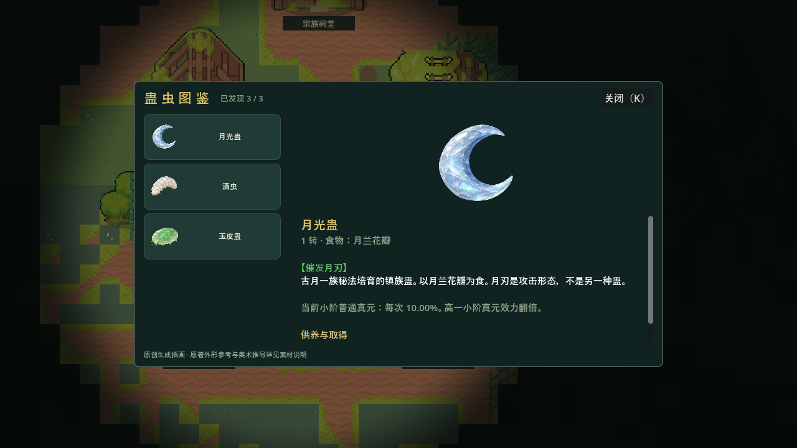
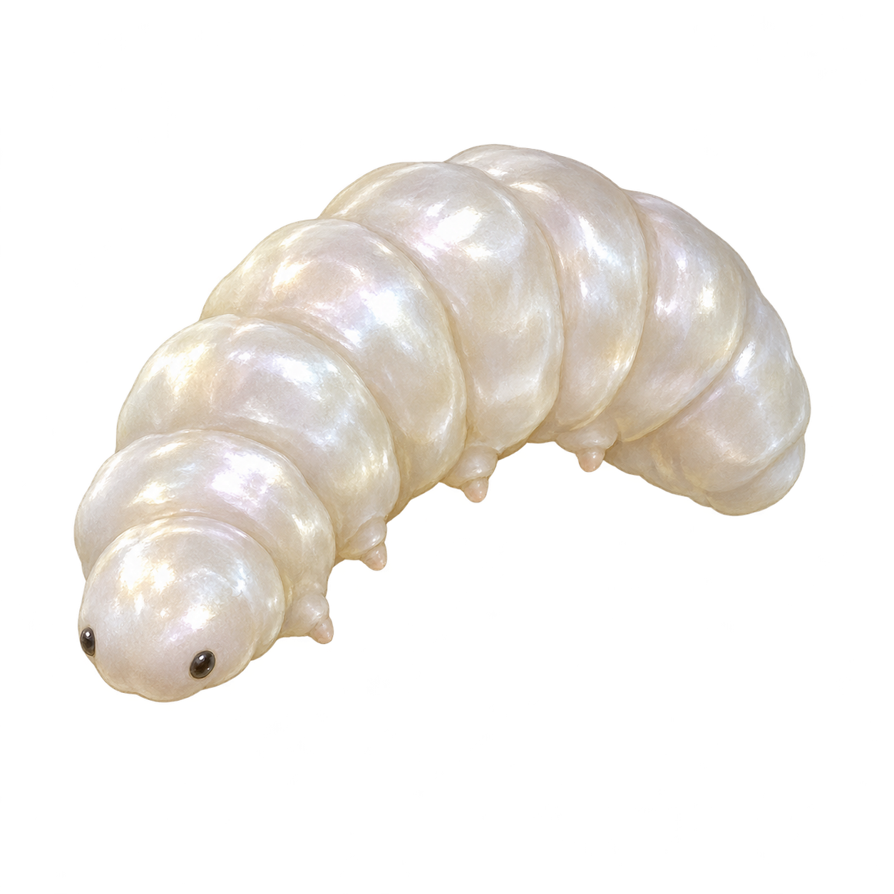
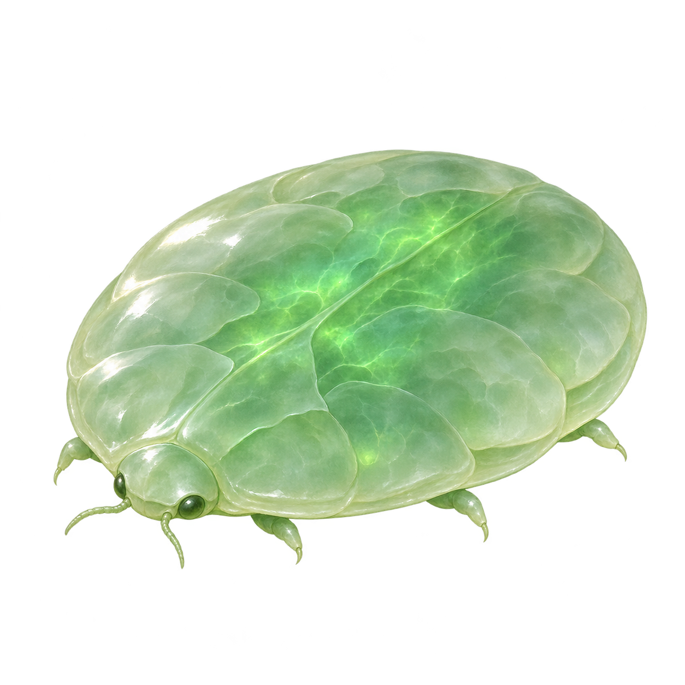

# 蛊道修仙：青茅山

**Cultivation in the Gu Realm** — 基于 Godot 4.3 的 2D 实时自由探索试玩。以《蛊真人》青茅山前期为世界背景，围绕蛊虫的用、养、炼与空窍修行展开，不强制复演小说剧情。

当前是可运行的单机原型，正式开放月光蛊、酒虫、玉皮蛊。地图、交易和委托中的游戏参数与原著依据分别记录在 [CANON](godot/CANON.md)，不宣称全书内容已经还原。



## 启动游戏

需要 **Godot 4.3 标准版**，渲染器使用 **GL Compatibility**。Python 3.10 或更高版本仅用于仓库检查脚本，游戏运行不依赖 Python。当前有 Windows 验证记录，其他平台尚未验收。

1. 克隆或下载本仓库。
2. 用 Godot 项目管理器导入 [godot/project.godot](godot/project.godot)。
3. 等待素材导入，按 **F5** 运行。

如果 Godot 4.3 已配置为终端的 `godot` 命令，可以在仓库根目录执行：

```powershell
git clone https://github.com/pgszz/-Cultivation-in-the-Gu-Realm.git
Set-Location -LiteralPath './-Cultivation-in-the-Gu-Realm'
godot --headless --editor --path ./godot --import
godot --path ./godot
```

完整操作和第一次探索路线见 [快速上手指南](快速上手指南.md)。

## 当前可玩内容

| 系统 | 已接入内容 |
| --- | --- |
| 自由探索 | 160×120 格地图，九处室内入口、九个野外探索点，滚轮缩放、迷雾与步行标记 |
| 用养炼 | 三种蛊独立插画、炼化、专属食物、饥饿死亡、本命关系及三个催蛊快捷位 |
| 修行 | 一转四小阶，打坐温养窍壁、手动冲关、酒虫精炼真元；击杀不奖励修为 |
| 人体 | 玩家 15 组部位、出血与疼痛、眼伤影响视野、包扎和自然恢复；毁损部位不再生 |
| 环境与人物 | 进出建筑、遮挡渐隐、攻击 NPC、敌对/死亡影响服务、树木与建筑等受损和持久化 |
| 生计 | 采集、材料出售、五项可选委托、两个营地的补给与包扎、游历记录 |
| 保存 | `canon_save.json` version 6；兼容 version 4/5 的已支持字段，保留旧 `save.json` |

**背包、空窍与快捷位分别管理**：I 存外部物品和外部蛊；Q 管理元海、窍壁、蛊虫居处；1/2/3 绑定实例，不限制拥有蛊虫的数量。

## 常用操作

| 输入 | 功能 |
| --- | --- |
| WASD / 方向键、左键、空格 | 移动、朝鼠标普攻、疾步 |
| E、滚轮 | 进屋/交互、缩放镜头 |
| R、J、1/2/3 | 炼化、打坐/收功、催蛊 |
| C / Q / B / I / M / V | 人物 / 空窍 / 身体 / 背包 / 山志 / 蛊术 |
| K、H、F1、Esc | 图鉴、包扎、收起 HUD、关闭菜单/暂停 |

开局携带的是**未炼化月光蛊**：先按 R 炼化，完成后在 Q 绑定快捷位。去商铺购买蛊食；山寨委托在商铺或学堂接取。探索、采集和打坐都不要求先完成剧情。

## 蛊虫图片

全部当前正式蛊图位于 [godot/assets/gu/painted](godot/assets/gu/painted)，为 1254×1254 的透明 PNG。

| 月光蛊 | 酒虫 | 玉皮蛊 |
| --- | --- | --- |
|  |  |  |

玉皮外观是参考皮蛊同系轮廓与翠绿护体效果的美术推导。生成记录和第三方素材来源见 [CREDITS](godot/CREDITS.md)。

## 文档导航

| 主题 | 文档 |
| --- | --- |
| 游玩与规则 | [快速上手](快速上手指南.md)、[详细玩法](godot/README.md)、[核心设定](核心设定对比.md)、[原著依据](godot/CANON.md) |
| 蛊虫与身体 | [蛊虫图鉴](蛊虫图鉴.md)、[供养系统](蛊虫饥饿度系统设计.md)、[人体结构](人体结构系统设计.md) |
| 世界与交互 | [地图](地图设计.md)、[世界结构](世界维度系统设计.md)、[环境破坏](环境破坏系统设计.md)、[蛊术效果](元素碰撞反应.md)、[整合链路](环境破坏系统+元素反应整合.md) |
| 生态边界与计划 | [植物](植物系统设计.md)、[动物](动物系统设计.md)、[异兽规划](妖兽系统设计.md) |
| 开发与验证 | [技术方案](技术方案.md)、[检查清单](开发检查清单.md)、[验证记录](godot/VALIDATION.md)、[文档维护](文档维护说明.md)、[协作说明](AGENTS.md) |
| 素材与截图 | [资源清单](免费资源清单.md)、[接入指南](资源获取实操指南.md)、[素材署名](godot/CREDITS.md)、[截图索引](godot/screenshots/README.md) |
| 尚未实现的联机 | [多人设计](多人联机详细设计.md)、[部署边界](服务器部署指南.md) |

## 检查项目

在仓库根目录执行：

```powershell
python -X utf8 tools/check_docs.py
python -X utf8 tools/check_game.py --godot 'C:/Tools/Godot/Godot_v4.3-stable_win64_console.exe' --checks canontest
```

将 `--godot` 换成实际 Godot 4.3 路径。`check_game.py` 会复制项目并隔离测试存档；不要直接在玩家存档目录运行自测。最近一次游戏回归在 1280×720 和 960×540 下分别通过 **208 项断言**，日期、覆盖与限制见 [VALIDATION](godot/VALIDATION.md)。文档整理不会冒充新的游戏回归。

## 仓库结构与范围

`godot/` 包含场景、脚本、素材与截图；根目录 Markdown 是主题文档；`tools/` 提供检查脚本；`.agents/skills/` 提供项目协作技能。缓存、导出产物、玩家存档、本地 `_archive/` 历史和 `.test-runs/` 测试副本不提交。

尚未开放：跨转、更多蛊与合炼、完整五域和三寨内容、完整野生寄生生态、未炼化蛊供养、多人联机及专用服务器。后续计划以可验证的功能为单位推进，不以旧版排期或虚构数据充数。

## 素材与许可记录

第三方素材的作者、许可文件和具体使用范围统一保存在 [CREDITS](godot/CREDITS.md)。本仓库没有附小说全文；生成插画、第三方素材和原著设定分别记录来源。项目代码尚未指定统一开源许可证。
