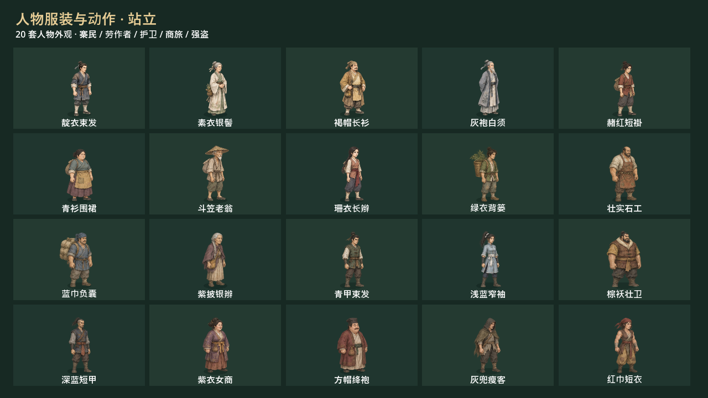
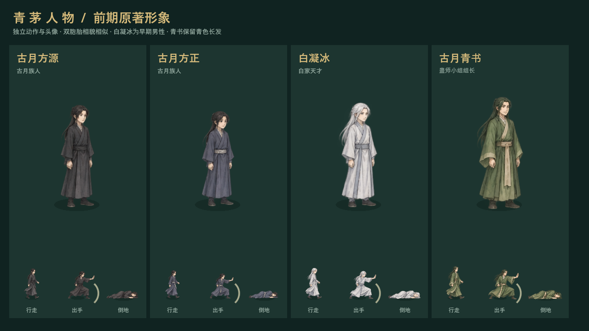

# 原创场景美术与动画

更新：2026-11-20。[游玩说明](README.md) · [素材来源](CREDITS.md) · [验证记录](VALIDATION.md)。

人物、建筑和地图采用原创青绿山水与墨彩风格。六幅正式 PNG 由内置 image_gen 制作并原样复制到 [painted_world](assets/painted_world)，每幅 1536×1024；完整提示词、生成来源、SHA-256 和透明通道范围见 [SOURCE.json](assets/painted_world/SOURCE.json)。建筑形制、服装、人物身份与五域轮廓是游戏美术表达，不宣称官方插画或原著精确复原。

## 已接入的画面

| 图集 | 实际使用 |
| --- | --- |
| character.png | 主角四朝向；每向站立、两步行走、出拳、催蛊和倒地，共 24 格；人物页显示同一角色立绘 |
| residents_clean.png | 寨中蛊师、药师、掌柜、学堂长者四套外观；每套站立、两步行走、出拳、受击和倒地，共 24 格；左右朝向镜像，未另画背面 |
| people/villagers.png | 赭衣青年、围裙妇人、斗笠老翁、长辫女子四套寨民外观 |
| people/workers.png | 背篓采竹人、壮实石工、蓝巾挑夫、银辫行脚人四套外观 |
| people/guards.png | 青甲守卫、浅蓝女巡卫、棕袄壮卫、深蓝镖师四套外观 |
| people/wayfarers.png | 紫衣女商、方帽掌柜、灰兜强盗、红巾强盗四套外观 |
| buildings.png | 九款基础建筑/洞口与三类废墟，共 12 格；街区扩建的 25 处入口按建筑类型复用 |
| scenery.png | 竹林、树、山峰、岩石、床、桌、储物箱和置物架，共 8 格；室内家具与人物按脚底位置排序 |
| terrain.png / shang_city 地面 | 原六种基础材质与商家城批次八种新材质按区域取用；真实网格烘焙、接边羽化，保留碰撞、路网与分块缓存 |
| atlas.png | M → 五域示意的山水地图；仍只选择地理说明，不提供其他四域的游玩或传送 |

青茅山可缩放地图仍按真实世界坐标绘制地形与迷雾，建筑标记复用新图，山体高度由方块颜色表示。大地图插画不替换导航坐标。水帘、梯田、篝火、旧炉、界面和人体示意等仍由代码绘制，并非所有画面都已改成独立插画。

人物和居民使用连续姿态切换配合程序变换：行走有抬步，普攻有前倾与收势，催蛊抬掌，受击后仰，疾步带残影。主角四朝向跟随实际移动，攻击时锁定鼠标方向；主角步态按实际行走距离推进，停步、撞墙收步，进出屋及读档位移不计为行走。玩家部位受损有局部冲击反馈，毁损时加强；未制作逐部位断肢图集，伤势规则仍以 BodyComponent 为准。死亡倒地过渡为 0.72 秒，玩家死亡立即停止玩法结算并锁定角色存档，倒地结束后显示返回角色选择界面；该角色不能复活。

## 人员服装与外貌

在原四套居民外观之外，新增十六套人物，共二十套通用外观；另有下方四位原著人物专属形象，总计 24 套。新增四张图集位于 [people](assets/people)，每张六列、四行，每套有站立、两步行走、出拳、受伤、倒地六格。男女、年龄、身材、发型、帽子、围裙、长短衣、背篓与行囊形成轮廓差异，不依赖全图换色。完整生成提示词与来源见 [SOURCE.json](assets/people/SOURCE.json)。

[NpcAppearance.gd](scripts/NpcAppearance.gd) 按固定身份和职业分配形象：同寨四名移动寨民不同，巡卫两人不同，商队四人不同，两个强盗营地各自两人不同；两寨住户、掌柜、工匠和守寨人也接入对应服装。地图、查看页及遗体共用同一外观与动作区域。`appearance` 随人物保存；旧档缺字段、非法标识都按身份稳定回退，不随机换脸。

这些 NPC 的衣服、护甲和行囊是角色美术，没有新增 NPC 装备数值、换装菜单或武器伤害。三寨仍可出现使用同一套基础形象的人员；通用部分为二十套完整动作形象，未实现逐个 NPC 程序组合捏脸。新增图集仍使用左右镜像，未新增独立背面。



实际动作、商队和人物查看页见 [截图索引](screenshots/README.md#人员服装与外貌--2026-11-18)。

## 玩家自定义衣装

玩家另有“衣冠工坊”，支持三种程序绘制衣装、三种发型、体型/衣形/颜色自定义，以及四方向人物与衣服 PNG 图集导入。内置衣装由代码生成几何轮廓、渐变和布褶，可导出为透明模板；原画主角仍可选用。工坊、实际玩家、选角页和人物页共用纹理，保存和死亡锁随独立角色处理。格式与模板见 [角色设计说明](CHARACTER_ART.md)。

## 破坏生命周期

非致命命中使物件短暂晃动并显示裂痕。致命命中立即结算耐久、碰撞、掉落与存档；绘制随后用原插画切成十二块，分段下坠、倾斜、扬尘，在 1.15 秒内接到木石废墟。室内家具和墙段复用同一表现；动画不参与伤害或掉落结算。

普通菜单暂停人物、居民和破坏动画。读档直接恢复死亡/废墟终态，清除临时晃动；修缮重置外观，恢复碰撞后可再次播放倒塌，但首次产料标记不会重置。原来的 F 检查、材料不足不扣款、原址占用检查和 NPC 服务状态保留。

## 开发与复查

[PaintedArt.gd](scripts/PaintedArt.gd) 统一提供纹理区域，[ATLAS.json](assets/painted_world/ATLAS.json) 保存按透明轮廓测得的地物裁切框；生成 PNG 未做离线像素修改。角色保持等大的格子与脚底基线，防止动作切换忽大忽小。居民第一版残留浅色背景，已用 image_gen 去底后改用 residents_clean.png；SOURCE 保留替换说明。

[ActorAnimation.gd](scripts/ActorAnimation.gd) 管人物动作，[CollapseAnimation.gd](scripts/CollapseAnimation.gd) 管碎片，[WorldProp.gd](scripts/WorldProp.gd) 与 [HouseInterior.gd](scripts/HouseInterior.gd) 接收实际破坏通知。[InteriorFixtureVisual.gd](scripts/InteriorFixtureVisual.gd) 让家具与人物共享 Y 排序。

```powershell
python -X utf8 tools/check_game.py --checks arttest canontest --screenshots village interior worldmap character repair damageinterior --resolution 1280x720 --timeout 120
python -X utf8 tools/check_game.py --checks appearancetest inspecttest populationtest --screenshots population caravan bandits --resolution 1280x720 --timeout 180
```

`arttest` 在隔离存档中检查真实攻击触发、暂停、伤势、倒塌、重建、读档终态和唯一产料，并保存分阶段截图。连续倒塌帧按固定模拟时间采样，仅用于复查表现，不冒充桌面人工操作录像。最终通过情况及失败快照单独记入 VALIDATION。

山体与地下洞网改为程序绘制的分层格子，顶面、断面、石纹、青苔、裂纹和玉脉由几何生成；不再用整山插画作为可碰撞山体。强力击碎方块有抛物、旋转和反弹碎块，暂停和切层行为见 TerrainTests。

## 原著关键人物 · 2026-11-19

在 20 套通用外观之外，新增方源、方正、白凝冰与青书四套独立动作形象，合计 24 套。透明六列四行图集 [qing_mao.png](assets/people/canon/qing_mao.png) 包含每人的站立、两步行走、出手、受击、倒地；场景、头像、查看及遗体使用同一来源。方正略矮于方源，青书略高；左右朝向仍为镜像，未制作背面或 3D 模型。

人物特点、原著与美术补充的界线见 [关键人物说明](../青茅山关键人物.md)；内置 image_gen 的完整提示词、哈希和原图信息见 [SOURCE](assets/people/canon/SOURCE.json)。图集像素原样保留。M → 青茅人物可以浏览、查看依据和标记常去区域；独立人物不会替换玩家或普通居民。


