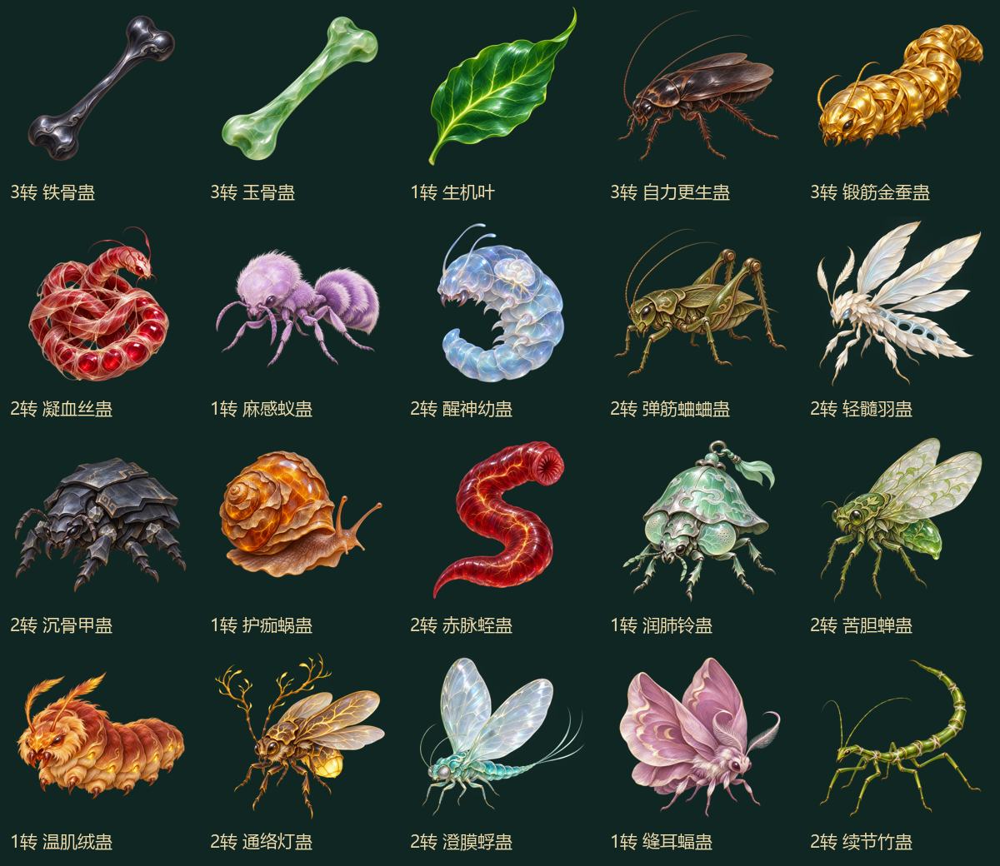

# 肉身状态蛊 · 二十种扩充

更新：2026-11-20。新增 **20 种**，正式名录由 100 种增至 **120 种**：一转 58、二转 33、三转 14、四转 9、五转 6。希望蛊仪式仍单独计数。本批含四种原著蛊和十六种明确标注的原创蛊，全部有独立透明 PNG、转数、稀有度、供养与实际效果。

## 取得与使用

按下表到对应商铺购买未炼化蛊，用 R 炼化；在 Q 收入空窍并绑定 1/2/3；当前身体寄居入口仅开放月光、小光，本批肉身蛊尚不能经界面寄居身体。体外背包中的蛊不可催动。需要选部位的护痂、续节先在 B 点选部位，再关闭菜单施放。K 图鉴增加“肉身”分类，C 人物页显示永久改造、限时状态、数值和代价，B 身体页显示作用于所选部位的说明。

各店每种蛊总库存一只；全部 20 种独立供养在三寨商铺出售，每份 1 元石、恢复 100 饥饿、按一游戏日一份模拟。原著蛊的专用供养不声称是已核实食谱；原创口粮为游戏设定。本批没有新增合炼方，催动或杀敌不会让蛊自动升转。各蛊至少需对应角色转数；本命实例不能主动消费。这些投放、费用、限制与稀有标记均为游戏设计。

## 名录与实际效果

下表耗元为同转初阶普通真元；中/高/巅峰按现有真元效力折算。限时蛊冷却均为 28 秒，按模板共享，换快捷键或换同种实例不能绕过。消耗型蛊无额外冷却。

| 蛊虫 / 插画 | 转数与来源 | 商铺 / 元石 | 初阶耗元 | 身体变化 |
| --- | --- | --- | --- | --- |
| [铁骨蛊](godot/assets/gu/painted/iron_bone.png) | 3转 · 原著改编 | 熊家商铺 / 1800 | 30 | 骨骼永久强化：头颈、胸腹、骨盆及四肢的部位伤害 ×0.80；气血伤害不变。消耗一只，疼痛 +65。与玉骨互斥；静处、疼痛低于 35、血量至少 70 才可用。 |
| [玉骨蛊](godot/assets/gu/painted/jade_bone.png) | 3转 · 原著改编 | 白家商铺 / 1800 | 30 | 骨骼永久强化：头颈、胸腹、骨盆及四肢的部位伤害 ×0.70；气血伤害不变。消耗一只，疼痛 +65。与铁骨互斥；静处、疼痛低于 35、血量至少 70 才可用。 |
| [生机叶](godot/assets/gu/painted/vitality_leaf.png) | 1转 · 原著改编 | 古月商铺 / 180 | 0 | 消耗一片：气血 +12，所有未毁损部位耐久 +6；不补血、不止血、不再生。无伤时不消耗。 |
| [自力更生蛊](godot/assets/gu/painted/self_reliance.png) | 3转 · 原著改编 | 熊家商铺 / 1800 | 12 | 持续 8 秒：每秒恢复气血及最伤的未毁损部位，速率为（基础肉身攻击＋永久豕力）×0.12，最高 6；同时每秒耗体力 2。筋骨强化使疗效降低。 |
| [锻筋金蚕蛊](godot/assets/gu/painted/tempered_sinew.png) | 3转 · 原创 | 熊家商铺 / 1800 | 12 | 静处每秒锻筋进度 +2.5%，一次最多 20 秒；永久上限 100%。满进度使四肢部位伤害 ×0.85、蛮力新增负担 ×0.65。移动、攻击、受击或打坐中断；预付耗元不返还。 |
| [凝血丝蛊](godot/assets/gu/painted/clot_thread.png) | 2转 · 原创 | 古月商铺 / 650 | 12 | 15 秒内所有伤口失血速度 ×0.45；没有封闭伤口，结束后恢复出血。颈部致命倒计时不受影响。 |
| [麻感蚁蛊](godot/assets/gu/painted/numb_ant.png) | 1转 · 原创 | 熊家商铺 / 180 | 12 | 12 秒内新受伤产生的疼痛 ×0.35；不消除已有疼痛、不降低伤害、不阻止失血昏迷。 |
| [醒神幼蛊](godot/assets/gu/painted/lucid_larva.png) | 2转 · 原创 | 白家商铺 / 650 | 12 | 12 秒内意识 +2/秒，最高 100；须清醒主动催动，头部重伤仍持续压低意识。 |
| [弹筋蛐蛐蛊](godot/assets/gu/painted/sinew_spring.png) | 2转 · 原创 | 熊家商铺 / 650 | 12 | 10 秒内徒手攻速 ×1.30，每秒体力 -1；双臂须未毁损且至少一臂不重伤。体力耗尽即停，不强化月刃。 |
| [轻髓羽蛊](godot/assets/gu/painted/feather_marrow.png) | 2转 · 原创 | 白家商铺 / 650 | 12 | 12 秒内移速 ×1.25，但所有部位所受伤害 ×1.20；伤腿与碰撞规则不变。 |
| [沉骨甲蛊](godot/assets/gu/painted/ballast_bone.png) | 2转 · 原创 | 熊家商铺 / 650 | 12 | 15 秒内骨盆与双腿部位伤害 ×0.65，移速 ×0.80；不减少气血伤害、不恢复毁损腿。 |
| [护痂蜗蛊](godot/assets/gu/painted/scar_crust.png) | 1转 · 原创 | 古月商铺 / 180 | 12 | B 页选定一个未毁损部位：15 秒内该部位伤害 ×0.55；只保护选定部位，不补耐久、不封血。 |
| [赤脉蛭蛊](godot/assets/gu/painted/red_pulse.png) | 2转 · 原创 | 古月商铺 / 650 | 12 | 10 秒内血量 +1.2/秒，气血 -0.6/秒；气血降至 15 自动停止。血量满或气血不足时不可用，不止血。 |
| [润肺铃蛊](godot/assets/gu/painted/lung_bell.png) | 1转 · 原创 | 白家商铺 / 180 | 12 | 16 秒内体力额外恢复 +5/秒；胸腹须未毁损且耐久高于 30%，失去条件立即结束。 |
| [苦胆蝉蛊](godot/assets/gu/painted/bitter_liver.png) | 2转 · 原创 | 古月商铺 / 650 | 12 | 15 秒内中毒剩余时间额外减少 3 秒/秒；胸腹须高于 30% 耐久。不清除灼烧、不修复伤势。 |
| [温肌绒蛊](godot/assets/gu/painted/warm_muscle.png) | 1转 · 原创 | 熊家商铺 / 180 | 12 | 12 秒内迟缓剩余时间额外减少 3 秒/秒；不提供火伤抗性，不解除麻痹。 |
| [通络灯蛊](godot/assets/gu/painted/nerve_lantern.png) | 2转 · 原创 | 白家商铺 / 650 | 12 | 12 秒内麻痹剩余时间额外减少 4 秒/秒，但新受伤疼痛 ×1.35。与麻感、醒神互斥。 |
| [澄膜蜉蛊](godot/assets/gu/painted/clear_cornea.png) | 2转 · 原创 | 白家商铺 / 650 | 12 | 8 秒内双眼中未毁损的受伤眼耐久 +0.65/秒，视野随真实眼伤恢复；双眼均毁损不能用。受击中断。 |
| [缝耳蝠蛊](godot/assets/gu/painted/ear_suture.png) | 1转 · 原创 | 古月商铺 / 180 | 12 | 8 秒内未毁损的受伤耳耐久 +0.8/秒、疼痛 -0.5/秒；不凭空增加听觉或视野。受击中断。 |
| [续节竹蛊](godot/assets/gu/painted/joint_mender.png) | 2转 · 原创 | 熊家商铺 / 650 | 12 | B 页选未毁损的受伤手臂或腿：10 秒内耐久 +1.5/秒、蛮力负担 -2/秒，移速 ×0.75；受击中断，不能接回断肢。 |

## 原著核对与改编边界

以下为正文转述，小说全文仅作为本地研究缓存，没有打包进游戏。

| 正文 | 已核实内容 | 当前改编与未模拟项 |
| --- | --- | --- |
| [第二卷 26](https://www.bilixs.com/novel/guzhenren/5374785.html)、[第二卷 29](https://www.bilixs.com/novel/guzhenren/5374788.html) | 玉骨改变骨骼、效果永久、一次性消耗，伴随剧痛；三转骨蛊；绿色玉质、两端圆润中段细长 | 玉骨部位伤害倍率 0.70、与铁骨互斥及使用门槛是本作限制；没有冰肌玉骨联动，也不模拟中途失败或疼死 |
| [第二卷 33](https://www.bilixs.com/novel/guzhenren/5374792.html)、[第二卷 34](https://www.bilixs.com/novel/guzhenren/5374793.html) | 铁骨三转、黑色骨形、消耗后强化骨骼；使用剧痛；能提高身体承载力 | 只映射到八组含骨部位耐久伤害 ×0.80，不让皮肉和气血一概减伤；瞬间完成、痛 +65、安全门槛均为模拟。没有外来高转真元代催机制 |
| [第一卷 157](https://www.bilixs.com/novel/guzhenren/5374716.html)、[第一卷 158](https://www.bilixs.com/novel/guzhenren/5374717.html) | 九叶生机草为二转，能催生一转生机叶，叶片用于治疗而非持续疗伤 | 本批仅接入生机叶；一次性气血 +12、全部未毁损部位 +6，费用和商铺取得为游戏映射；未接入九叶生机草生产链。叶脉、荧光与装饰为美术解释 |
| [第二卷 93](https://www.bilixs.com/novel/guzhenren/5374852.html) | 自力更生为三转治疗蛊，只能治疗自身；肉身力量越强治疗越好；强化筋腱的道痕会阻碍疗伤；黑褐扁平蟑螂形、长触角、前后双翅 | 每秒恢复气血与当前最伤的一个存活部位，基础速率 min(6, (基础攻击 + 永久豕力) ×0.12)，再除以 (1 + 骨改造0.35 + 锻筋进度×0.25)；持续8秒、体力费用是模拟。临时攻击加成不计入，无法给NPC治疗或重生断肢 |
| [第二卷 89](https://www.bilixs.com/novel/guzhenren/5374848.html)、[第二卷 90](https://www.bilixs.com/novel/guzhenren/5374849.html) | 钢筋通过一段时间反复使用改造筋腱，与一次性骨蛊不同 | 仅作为“锻筋金蚕”原创玩法的参考。锻筋金蚕不是原著钢筋蛊；20秒、2.5%/秒、减伤和负担公式均明确原创 |

本批不恢复已经毁损的眼、耳、手臂、腿或其他部位，也不复活死亡角色。原著涉及但目前未模拟的痛死、冰肌玉骨组合、骨骼/筋腱独立解剖层、再生与完整疗伤道痕规则，不宣称已还原。

## 互斥、持续与代价

- 铁骨与玉骨只能选择一种，一次性改造保存后不因取出蛊或读档丢失；不改变部位最大耐久，不补满耐久，不减气血伤害。
- 锻筋进度永久共享、上限100%；满进度时四肢部位伤害 ×0.85，蛮力新增负担 ×0.65，与原豕蛊负担倍率相乘。移动、受击、攻击、打坐会中断，已获得进度保留，预付真元不返还。
- 血脉组：凝血与赤脉互斥。神经组：麻感、醒神、通络互斥。运动组：弹筋、轻髓、沉骨互斥。修复组：自力更生、澄膜、缝耳、续节互斥。不同组可以组合，各自的部位和身体条件仍然有效。
- 凝血只降低 `BodyComponent` 伤口失血；不改变流血状态的气血伤害，不包扎伤口，不延长颈部致命倒计时。麻感只影响新疼痛，不减少伤势或失血。
- 弹筋、自力更生按实际剩余体力限制结算；体力不足时不会先给完整疗效再扣费。赤脉按实际血量缺口及气血预算停止，低于气血15时不会把气血反向补至15。
- 移出至背包、蛊死亡、人物死亡、切换室内或地图层会清理临时效果；普通菜单与炼化工作期间身体蛊计时暂停，离线不推进。冷却保留，读档不恢复临时效果。已支付成本不返还。

## 接入与保存

`GameData.BODY_GU` 是本批20种列表；正式数据仍在 GDScript 字典，没有新增 JSON 运行加载器。`Main.cast_skill` 在现有开窍、转数、身体、实例与快捷冷却检查后调用 `BodyGuEffects`；`BodyComponent` 应用部位伤害、疼痛和出血倍率；`PlayerStatus.movement` 应用移速；普攻使用实际身体攻速；`GuEffects` 读取锻筋后的蛮力负担倍率。

正式角色 version 8 增加可选 `body_gu` 对象：`bone`、`tendon_progress`、`cooldowns`。旧档缺失时为无骨改造、进度0、无冷却。临时 `active` 不落盘。消耗型蛊把真元、身体变化、实例删除、饥饿注销与快捷位清理作为一次保存事务；保存失败完整撤回。普通治疗成果随既有身体和气血字段保存。

图片使用内置 image_gen 逐种独立生成，原始透明PNG直接复制，没有把拼图裁成素材。提示词见 [BODY-PROMPTS](godot/assets/gu/painted/BODY-PROMPTS.json)，来源与SHA-256见 [SOURCE](godot/assets/gu/painted/SOURCE.json)。通络灯首轮服务502，重试补齐；本批20图摘要各不相同，最终蛊图共121张（含希望蛊）。

## 验证

专项入口 `bodygutest`：真实商铺按钮、炼化、独立喂养、全部20种施放、资源不足、部位与转数条件、实际伤害/失血/视野/攻速变化、互斥/到期/移出/死亡、禁止再生、消费保存与回滚、旧档默认及两个分辨率界面。结果和复现命令见 [验证记录](godot/VALIDATION.md)，截图见 [截图索引](godot/screenshots/README.md)。
