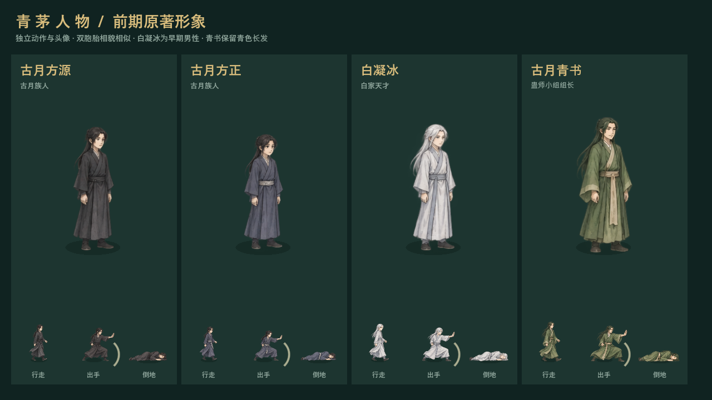

# 青茅山关键人物与原著形象

更新：2026-11-19。入口：[项目首页](README.md) · [游玩说明](godot/README.md) · [原著边界](godot/CANON.md) · [美术](godot/ART.md)。

首批四人是古月方源、古月方正、白凝冰、古月青书。用户所说的“古月方原”按原著人物古月方源处理。项目仍为 2D，独立形象包含站立、两步行走、出手、受击、倒地六格，以及从同一图集裁切的人物立绘、头像。没有改成 3D 模型。

## 正文依据与美术取舍

核对的是小说正文镜像，未将同人插画当成外貌依据。以下均为转述，不复制长段正文。

| 人物 | 正文支持的特征 | 本作采用的美术补充 |
| --- | --- | --- |
| 古月方源 | 与方正相貌相似；惯常冷漠；黑眸、神色平淡 | 墨色交领衣、束发方式和克制的出手动作；没有采用后期至尊仙体形象 |
| 古月方正 | 孪生弟弟，体型消瘦、比哥哥稍矮，面容极似，开篇习惯低头 | 同一五官基础，稍小轮廓、灰蓝衣衫与浅腰带；拘谨是开篇表现，不等同于他后续所有阶段 |
| 白凝冰 | 青茅山前期的男性少年，白发白袍；第 133 节求战时眼瞳由黑变蓝 | 保留常态黑瞳，出手格表现蓝眸；衣褶、腰带和徒手姿势为补充，未混入后期女性、龙人或独臂形态 |
| 古月青书 | 青色长发，面色白皙、脸部线条柔和，笑容温和且自信，关照组员 | 青绿衣装、米色腰带、略高轮廓与舒展站姿；保持常态人形，没有把木魅变化画成日常外貌 |

来源：

- [第一卷第二节：逆光阴五百年觉悟](https://czbooks.net/n/u30h/ujch9)：兄弟相貌、身形差异、方正低头和方源惯常表情。
- [第一卷第一百零四节：想买酒虫？](https://www.sobqg.com/read/guzhenren/18153074.html)：青书用蛊、青色长发、面容、气质及照顾组员。
- [第一卷第一百三十一节：孤独是最深邃的黑暗](https://www.sobqg.com/read/guzhenren/18153101.html)：白凝冰的白发白衣、少年形象与旁观态度。
- [第一卷第一百三十三节：谢谢你让我杀你](https://www.sobqg.com/read/guzhenren/18153103.html)：方源黑眸、白凝冰黑瞳变蓝、白袍和求战性格。

这些造型是青茅山前期的外貌切片，不声称四人处于正文同一天、同一套修为和蛊虫配置。发束、衣纹、未明确指定的配色与动作均属美术设计，游戏“原著”页也明确列出。

## 如何找到与查看

按 **M → 青茅人物 · 原著形象**，查看四人立绘与形象说明，点击“原著依据”阅读章节摘要，或“标记常去区域”返回青茅山地图并添加方向标点。这里标记的是稳定的会面区域，不跟踪人物实时位置。

| 人物 | 常去区域 | 日常活动路线 |
| --- | --- | --- |
| 方源 | 古月竹楼外 | 竹楼外、东街、寨南竹路 |
| 方正 | 古月学堂外 | 学堂外、寨中街巷、竹楼南路 |
| 白凝冰 | 白家寨东街 | 东街、演武路、白家南路 |
| 青书 | 祠堂南街 | 祠堂南街、东街、学堂路口、药堂外 |

路线、停驻地点、停留时长都是沙盒安排，不是原著精确坐标。抵达后靠近按 **E** 交谈；**Alt + 左键** 查看，人物资料多一个“原著”页签。地图人物、顶部头像、查看页和遗体使用同一身份图集。

四人的日常问候、生活、修行、山路话题和受伤答复分别编写，均为性格改编台词，不是原著引文。交谈、包扎仍由原有规则验证距离、障碍、敌对、存活状态与物品消耗，并记录实际交往。兄弟关系以“孪生弟弟 / 孪生兄长 · 原著”标识；其他尚未接入的师承、剧情关系不自动编造。

## 接入、保存与边界

[CanonPeople.gd](godot/scripts/CanonPeople.gd) 管理原著摘要、身份、驻点和台词；[PopulationSystem.gd](godot/scripts/PopulationSystem.gd) 将原来的 30 名移动人员与新增四人一起实例化、寻路和保存。[NpcAppearance.gd](godot/scripts/NpcAppearance.gd) 为四个固定身份分配专属图集，错误或其他角色的存档外观不能替换他们的脸。

新增人物沿用角色 version 8 存档里的 `population.people`；旧档缺少四人时各补入一次，普通居民状态保留。位置、日程、交谈、社会关系、物品、敌对和死亡分别保存；死亡不会被重新加载自动复活，也不覆盖玩家自己的角色。

本次重点是原著形象与交互接入。尚未还原每人的完整蛊虫阵容、资质、修为成长或小说战斗剧情；属性页维持“未探明”。四人暂共用气血 100、徒手基础伤害 7、移动速度 68 像素/秒、出手间隔 1.3 秒等原型自卫参数，这些数值不表达原著强弱。他们遭攻击会自卫，不会自动变成追杀强盗的护商队。

图集使用左右镜像，尚无独立背面；不是逐部位可换装模型。原有 20 套通用人员外观保留，加上本次四套共 24 套。每格 256×256，透明 PNG 原始像素未离线修改，实际场景以原有角色大小显示，方正略矮、青书略高。

## 素材和验证入口

新增图集：[qing_mao.png](godot/assets/people/canon/qing_mao.png)。生成方式为内置 image_gen；完整提示词、原始生成文件名、布局与来源记录见 [SOURCE.json](godot/assets/people/canon/SOURCE.json)。这不是官方插画。

```powershell
python -X utf8 tools/check_game.py --checks canonpeopletest appearancetest populationtest inspecttest --resolution 1280x720 --timeout 240
python -X utf8 tools/check_game.py --checks canonpeopletest --resolution 960x540 --timeout 240
python -X utf8 tools/check_docs.py
```

[CanonPeopleTests.gd](godot/scripts/CanonPeopleTests.gd) 验证真实场景、旧档补人、固定身份、交谈与查看输入、兄弟关系、标点、正式存档与死亡持久化；外观专项另外检查六格动作和透明边角。实际通过记录及截图见 [VALIDATION](godot/VALIDATION.md)，不以正常退出代替断言通过。


